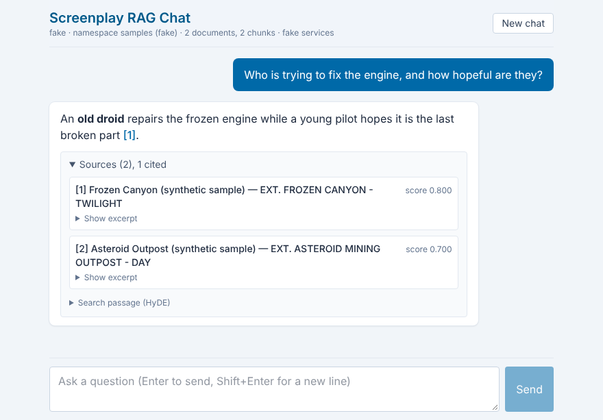

# Screenplay RAG Chat

Ask questions about movie screenplays you provide and get short answers that cite the scenes they come from. The app
uses retrieval-augmented generation (RAG): it splits screenplays into scenes, finds the scenes relevant to a question,
and has a small local model answer from those scenes only. It is a **portfolio and learning project**, not a
production system.



_The chat page with fake services (`FAKE_SERVICES=true`), so the answer shown is canned. Regenerate with
`bun run screenshot`._

## Features

- **Ingestion:** validates a manifest of up to 10 text screenplays, splits them into scenes and ~450-token chunks with
  semantic overlap, embeds them locally and stores them in Pinecone. One-shot, with a reset command.
- **Retrieval:** HyDE. The model imagines a scene that would answer the question; that scene, blended with the question
  (and the previous question for follow-ups), searches Pinecone.
- **Answers:** grounded in the retrieved scenes, with reasonable inferences worded as such, numbered citations `[1]`,
  and "not found" when the screenplays don't say.
- **Chat page:** streamed answers, collapsible sources with excerpts and the HyDE passage, Stop and New chat, status
  banners for setup problems. History lives in the browser for the session only.
- **Terminal:** `bun run ask` for one question or an interactive chat; `--show-prompts` prints every stage of a request.

## Stack

| Concern      | Choice                                                                                  |
| ------------ | --------------------------------------------------------------------------------------- |
| Runtime      | Bun 1.4.4 (`bun check`, `bun test`, `bun fmt`, `.env` loading, `fetch`)                 |
| UI           | SolidStart v2, SolidJS, Tailwind CSS v4                                                 |
| Chat model   | Ollama with `qwen3.5:4b`, the only runner; Ollama uses Apple's MLX backend ([ADR-0005]) |
| Embeddings   | Fastembed `fast-bge-small-en-v1.5` (384 dimensions), run locally                        |
| Vector store | Pinecone serverless, free Starter plan                                                  |
| Tooling      | Biome, cSpell (en-GB), commitlint, `Bun.WebView` end-to-end tests                       |

[ADR-0005]: docs/adr/0005-single-llm-runner.md

## Constraints

- One user and one chat session; the conversation is lost on reload or restart.
- Not an agent: it only reads its own data and calls its own models.
- Up to 10 user-provided text screenplays of 512 KB each.
- Real screenplays are never committed; the repository holds only [synthetic samples](data/samples/README.md).

## Quick start

Full walkthrough: [getting started](docs/getting-started.md).

```sh
bun install                                   # dependencies + the repo's git hooks
cp .env.example .env                          # then set PINECONE_API_KEY
ollama pull qwen3.5:4b
SCREENPLAYS_DIR=data/samples PINECONE_NAMESPACE=samples bun run ingest
PINECONE_NAMESPACE=samples bun run dev        # http://127.0.0.1:3000
```

## Commands

| Command                          | What it does                                                  |
| -------------------------------- | ------------------------------------------------------------- |
| `bun run dev`                    | Start the chat page at `http://127.0.0.1:3000`                |
| `bun run ask "question"`         | Ask from the terminal; no question starts an interactive chat |
| `bun run ask --show-prompts "…"` | Also print the prompts, search texts and scores of each stage |
| `bun run ingest`                 | Validate, chunk, embed and store the documents (one-shot)     |
| `bun run reset-store --yes`      | Empty the namespace so you can ingest again                   |
| `bun run doctor`                 | Check configuration, Ollama, the embedding model and Pinecone |
| `bun run chunk:preview <file>`   | Show how a screenplay is split into scenes and chunks         |
| `bun run verify`                 | Lint, format check, spelling, type check, unit tests          |
| `bun run e2e`                    | Build, then run the end-to-end tests with fake services       |
| `bun run screenshot`             | Build, then regenerate `docs/images/chat.png`                 |

## Documentation

| Topic                                      | Document                                                       |
| ------------------------------------------ | -------------------------------------------------------------- |
| Getting started                            | [docs/getting-started.md](docs/getting-started.md)             |
| How it works                               | [docs/how-it-works.md](docs/how-it-works.md)                   |
| Anatomy of a request (one question traced) | [docs/anatomy-of-a-request.md](docs/anatomy-of-a-request.md)   |
| Retrieval design                           | [docs/retrieval-design.md](docs/retrieval-design.md)           |
| Screenplay chunking                        | [docs/chunking.md](docs/chunking.md)                           |
| Architecture                               | [docs/architecture.md](docs/architecture.md)                   |
| Configuration                              | [docs/configuration.md](docs/configuration.md)                 |
| Ollama for beginners                       | [docs/ollama.md](docs/ollama.md)                               |
| Troubleshooting                            | [docs/troubleshooting.md](docs/troubleshooting.md)             |
| Limitations                                | [docs/limitations.md](docs/limitations.md)                     |
| Tidy-up resources                          | [docs/tidy-up.md](docs/tidy-up.md)                             |
| Legal and sample data                      | [docs/legal-and-sample-data.md](docs/legal-and-sample-data.md) |
| Backlog (GitHub Issues mirror it)          | [docs/backlog.md](docs/backlog.md)                             |

Architecture decision records:

- [ADR-0001](docs/adr/0001-stack-and-tooling.md) Stack and tooling
- [ADR-0002](docs/adr/0002-chunking.md) Screenplay chunking
- [ADR-0003](docs/adr/0003-ingestion.md) Ingestion
- [ADR-0004](docs/adr/0004-query-pipeline.md) Query pipeline
- [ADR-0005](docs/adr/0005-single-llm-runner.md) Single LLM runner (Ollama)
- [ADR-0006](docs/adr/0006-chat-ui.md) Chat UI

## Workflow

- Work is tracked in GitHub Issues and Milestones; [docs/backlog.md](docs/backlog.md) is the source of truth.
- One branch per milestone (`feat/m<N>-<slug>`) with one commit per issue, and a pull request into `main`.
- Commit messages follow [Conventional Commits](https://www.conventionalcommits.org/) with a sentence-case subject,
  for example `feat(chunker): Add scene heading registry`. The `commit-msg` hook and CI enforce it.
- Git hooks live in `.githooks/` and are enabled per repository by `bun install`
  (`git config --local core.hooksPath .githooks`).
