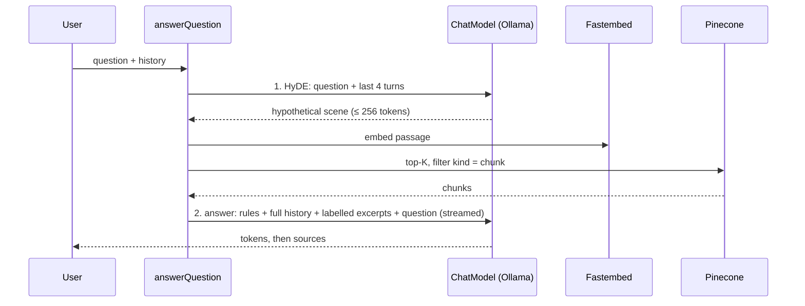

# ADR-0004: Query pipeline

- **Status:** accepted
- **Date:** 2026-10-25

## Context

Each question must be answered from the ingested screenplays by a small local model (`qwen3.5:4b`, 8192-token
context), with exactly two LLM calls per request, the full conversation history, and excerpts labelled with film title
and scene heading.

## Decision

- **Layering:** prompts and history fitting are pure (`src/rag/`); the Ollama client, retriever and orchestration are
  server-only (`src/server/`). `answerQuestion` yields events (`hypothesis`, `sources`, `history-trimmed`, `token`,
  `done`) that both the `ask` CLI and the M4 UI consume.
- **`ChatModel` interface:** `generate` and `stream`. `createChatModel(config)` returns the Ollama implementation; the
  optional MLX provider (M6) plugs in behind the same interface.
- **Ollama calls:** `fetch` to `/api/chat`; every call sends `think: false` (configurable), the same `num_ctx` and
  `keep_alive`, so the model is never reloaded between the two calls. Streaming is NDJSON; `message.thinking` is
  ignored.
- **HyDE:** the hypothetical passage is written in screenplay form, 80–150 words, with the last four turns so follow-up
  questions stay anchored. It is embedded with plain `embed()` (no title prefix), matching the stored chunks' style.
- **Retrieval:** Pinecone top-K (`TOP_K`, default 5) with `filter: { kind: { $eq: "chunk" } }` to exclude the
  ingestion sentinel.
- **Answer prompt:** system rules (excerpts only, cite `[Title — HEADING]`, say when not found, summarise rather than
  copy, be concise), then the full history, then a final user message with the labelled excerpts and the question.
- **History guard:** history is sent in full. Only if the estimated prompt would exceed `num_ctx − 1024` tokens are the
  oldest user/assistant pairs dropped, and the caller is told. Tokens are estimated as characters ÷ 3, recalibrated
  after each answer from Ollama's `prompt_eval_count`.

## Consequences

- Two sequential LLM calls add latency (about 1–2 s each warm on the M1), offset by streaming the answer.
- A poor hypothetical passage retrieves poor scenes; the evaluation set (later backlog) will measure this.
- The answer quality is bounded by a 4B model; the prompt keeps it grounded and makes "not found" an explicit option.
