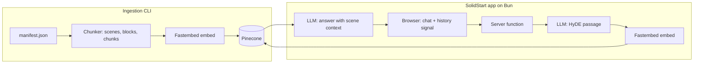

# Architecture

> Skeleton; completed in milestone M5.

## Modules

| Path          | Responsibility                                                   |
| ------------- | ---------------------------------------------------------------- |
| `src/ingest/` | Pure screenplay chunker (no network, no config)                  |
| `src/server/` | Server-only code: configuration, embedder, Pinecone, LLM clients |
| `src/routes/` | SolidStart pages and server functions                            |
| `scripts/`    | CLIs: chunk preview, ingest, reset store, doctor, ask            |

Decisions are recorded in [ADRs](adr/).
