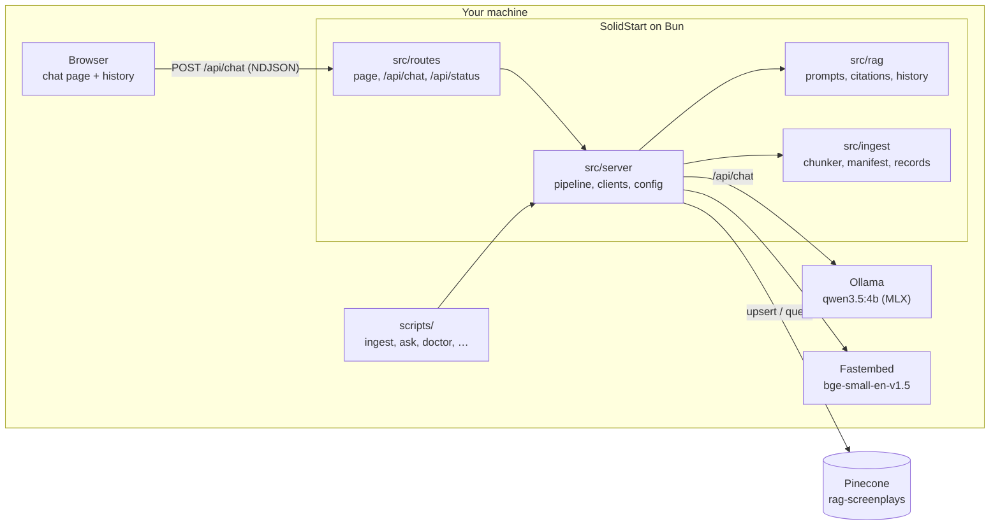
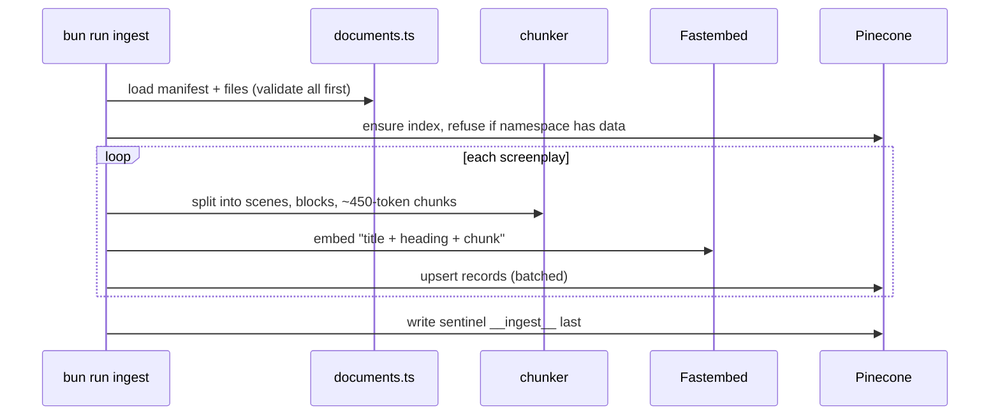
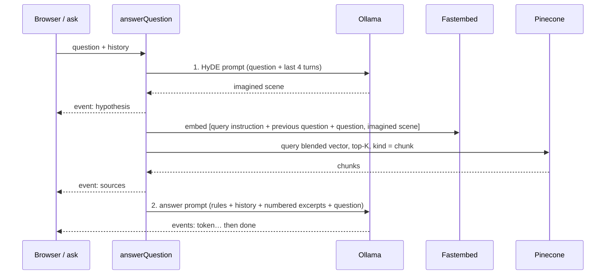

# Architecture

The app has two paths that share the same data: **ingestion** (a one-shot CLI that fills Pinecone) and **questions**
(the chat page or the `ask` CLI). Everything runs locally on Bun except Pinecone, which is a managed service.

## Components



## Modules and layering

| Path              | Responsibility                                                                | Rule                                  |
| ----------------- | ----------------------------------------------------------------------------- | ------------------------------------- |
| `src/ingest/`     | Chunker (lines, scenes, blocks, packing), manifest validation, record shape   | Pure: no IO, network or config        |
| `src/rag/`        | Prompts, citation parsing, history fitting, vector blending                   | Pure; safe to import in the browser   |
| `src/lib/`        | Markdown renderer, NDJSON helpers                                             | Client-safe                           |
| `src/server/`     | Config, documents, embedder, Pinecone store and retriever, Ollama, pipeline   | Server-only; never imported by client |
| `src/routes/`     | Chat page and API routes (`/api/chat`, `/api/status`)                         | Routes run on the server              |
| `src/components/` | Chat message and sources UI                                                   | Client components                     |
| `scripts/`        | CLIs: `ingest`, `reset-store`, `ask`, `doctor`, `chunk:preview`, `screenshot` | Wire config to `src/server`           |

The browser bundle contains no server code: the page imports only types from `src/server`, and pure helpers from
`src/rag` and `src/lib`.

## Ingestion flow



Details: [chunking](chunking.md), [ADR-0002](adr/0002-chunking.md), [ADR-0003](adr/0003-ingestion.md).

## Question flow



Details: [how it works](how-it-works.md), [anatomy of a request](anatomy-of-a-request.md),
[ADR-0004](adr/0004-query-pipeline.md), [ADR-0006](adr/0006-chat-ui.md).

## Data formats

**Manifest** (`${SCREENPLAYS_DIR}/manifest.json`):

```json
[{ "file": "frozen-canyon.txt", "title": "Frozen Canyon (synthetic sample)", "imdbId": "tt0000001", "synthetic": true }]
```

**Pinecone record** (one per chunk; ID `imdbId:sceneIndex:chunkIndex`, 384-dimension vector):

| Metadata      | Example                                           |
| ------------- | ------------------------------------------------- |
| `kind`        | `chunk`                                           |
| `imdb_id`     | `tt0000001`                                       |
| `title`       | `Frozen Canyon (synthetic sample)`                |
| `scene_index` | `0`                                               |
| `chunk_index` | `0`                                               |
| `heading`     | `EXT. FROZEN CANYON - TWILIGHT` (omitted if none) |
| `text`        | the exact chunk text                              |

**Sentinel** `__ingest__`: `kind: ingest`, `completed`, `documents`, `chunks`, `ingested_at`. Written last; its
presence means the namespace holds a complete ingestion.

**`/api/chat` stream** (NDJSON, one event per line):

```json
{"type":"hypothesis","text":"EXT. FROZEN CANYON - NIGHT\n\n…"}
{"type":"sources","chunks":[{"id":"tt0000001:0:0","score":0.58,"title":"…","heading":"…","text":"…"}]}
{"type":"token","text":"The old droid "}
{"type":"done","answer":"The old droid … [1].","charsPerToken":3.1}
```

Other events: `history-trimmed` (older turns dropped to fit the context window) and `error`.

## Decisions

[ADR-0001](adr/0001-stack-and-tooling.md) stack and tooling · [ADR-0002](adr/0002-chunking.md) chunking ·
[ADR-0003](adr/0003-ingestion.md) ingestion · [ADR-0004](adr/0004-query-pipeline.md) query pipeline ·
[ADR-0005](adr/0005-single-llm-runner.md) single LLM runner · [ADR-0006](adr/0006-chat-ui.md) chat UI
