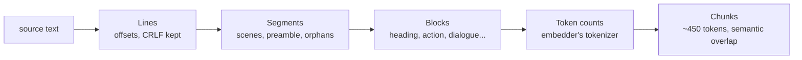

# Screenplay chunking

The chunker (`src/ingest/`) turns one screenplay into retrievable `Scene` chunks. It is pure and deterministic: no
network, no configuration, no vector-store code. Its only dependency is an injected token counter.

```ts
import { createModelCounter, splitScreenplay } from './src/ingest'

const counter = await createModelCounter('.cache/fastembed')
const scenes = await splitScreenplay('tt0000001', source, { counter })
```

## The invariant

Every emitted `text` is an exact `source.slice(start, end)`. Nothing is trimmed, normalised or labelled. Every
character that belongs to a scene appears in at least one chunk, in its original form and order. Overlap is simply
repeated source text; no type carries overlap metadata.

## Pipeline



### 1. Lines (`lines.ts`)

Lines keep their terminators, so `\r\n` survives. Each line is classified on `norm`: the content without form feeds,
trimmed. `norm` is never emitted.

### 2. Segments (`headings.ts`, `scenes.ts`)

Structural lines are recognised by an **ordered list of rule objects** (`DEFAULT_RULES`); the first match wins. Add a
rule, or pass your own list in `rules`, to extend recognition.

| Rule kind          | Examples                                                          | Role   |
| ------------------ | ----------------------------------------------------------------- | ------ |
| Scene heading      | `INT. HOUSE - DAY`, `12A EXT./INT. CAR`, `INT - LAB`, `I/E TRUCK` | opens  |
| Opening transition | `FADE IN:`, `IRIS IN`                                             | opens  |
| Terminator         | `THE END`, `END CREDITS`                                          | opens  |
| Closing transition | `CUT TO:`, `DISSOLVE TO:`, `FADE OUT.`, `IRIS OUT`, `CUT`, `PAN:` | closes |
| Page furniture     | `45.`, `(MORE)`, `CONTINUED:`                                     | none   |

Scene headings need an uppercase `INT`/`EXT` token (with optional scene number, dots, slashes and dashes) and letters
that are at least 80% uppercase, so `INT. McDONALD'S` matches and `Ext. walls crumble` does not. Transitions must be
the whole line, uppercase, with an optional trailing `:` or `.`, so dialogue like `Cut!` never matches.

Segmentation is a single pass:

- An opener starts a new segment. Everything after it belongs to that segment until the next opener.
- A closing transition stays as the last line of its scene.
- Text after a closing transition and before the next opener becomes an **orphan** segment with `heading: null`
  (page furniture and further transitions do not count).
- Text before the first heading is the **preamble** (`heading: null`), indexed like any scene.
- Blank lines between scenes stay with the earlier segment.
- A bodiless transition or terminator segment (e.g. `FADE IN:` straight before `INT.`, a final `THE END`) or a
  whitespace-only preamble merges into the next segment, or the previous one if it is last. A bodiless scene heading
  stays its own scene.

Segments partition the text exactly.

### 3. Blocks (`blocks.ts`)

Blocks are the indivisible units: the heading line, action paragraphs, transitions, page furniture and **dialogue
blocks**. A dialogue block is a character cue (`MARA (V.O.)`, `ROBOT #2`, `JOSÉ`) glued to any parentheticals and its
speech, even when blank lines separate them. When dialogue is indented more than action, further paragraphs at the same
indent are glued too. In exports without blank lines, a cue line after other text starts a new paragraph. Dialogue is
never split.

### 4. Token counting (`tokens.ts`)

Chunk sizes are measured with **the embedding model's own tokenizer** (`bge-small-en-v1.5` WordPiece, loaded from the
Fastembed cache with `@anush008/tokenizers`, pinned to the exact version Fastembed uses). Truncation and padding are
disabled and special tokens are excluded, so counts are exact and not capped at 512.

The model reads 512 tokens including `[CLS]` and `[SEP]`, so the budget is 510 minus the embedding prefix
(`title`, `heading`). The 450 target leaves room for that prefix.

WordPiece pre-tokenisation splits on whitespace, and every block ends at a line break, so block counts add up exactly
to chunk counts. Each block is counted once per scene.

Unit tests use `approximateCounter` (one token per word or punctuation mark), so CI never downloads a model.

### 5. Packing (`pack.ts`)

- A scene that fits the target produces **exactly one** chunk.
- Otherwise whole blocks are packed greedily up to about 450 tokens, overlap included.
- The next chunk starts with the largest suffix of whole blocks from the previous chunk that fits in 100 tokens. If
  even the last block is larger, there is no overlap. Overlap is therefore usually 50–100 tokens, sometimes less.
- A block larger than the target is kept intact as its own chunk, with an `oversized-block` warning, and a
  `truncation` warning when it exceeds the embedding budget (the stored text stays complete).
- A tail chunk that adds fewer than 50 new tokens merges into the previous chunk when the result still fits the
  embedding budget, so that chunk can exceed 450 (up to about 510).

## Preview

```sh
bun run chunk:preview data/samples/frozen-canyon.txt --verify   # real tokenizer (downloads the model once)
bun run chunk:preview my-film.txt --approx                     # fast approximate counts
```

Each chunk is printed with its heading, token count, overlap and block kinds. `--verify` checks that every character
is covered in order. Dividers are printed only; they are never part of `Scene.text`.

## Known limitations

- Spelled-out `INTERIOR`/`EXTERIOR`, `EST.`, mostly lowercase headings and headings on the same line as a transition
  (`FADE IN: INT. HOUSE`) are not recognised as headings. Add rules if needed.
- A bare `PAN` line is not a transition (it could be a character called Pan); `PAN:` and `PAN TO:` are.
- After a cue separated by blank lines, only one flush-left speech paragraph is glued.
- `(MORE)` / `(CONT'D)` dialogue is not joined across page breaks.
- An all-caps action line that looks like a cue (`BANG BANG`) glues the next paragraph into a larger unit.

Decisions and their rationale: [ADR-0002](adr/0002-chunking.md).
